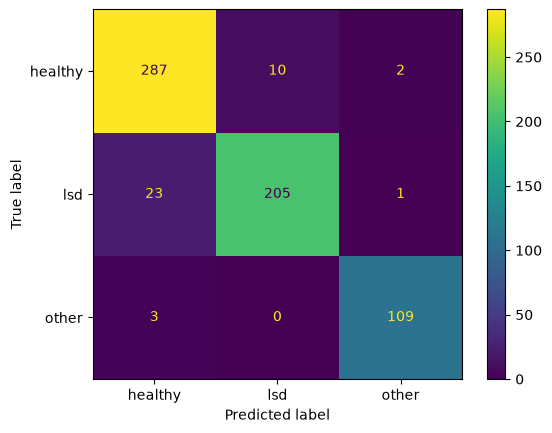
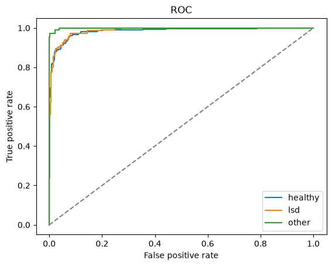
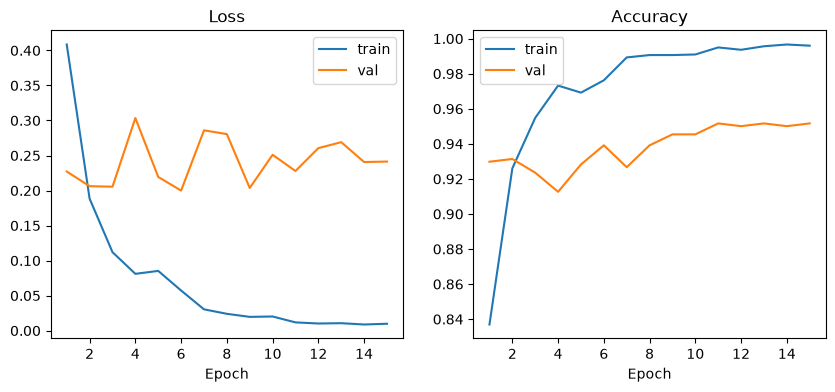
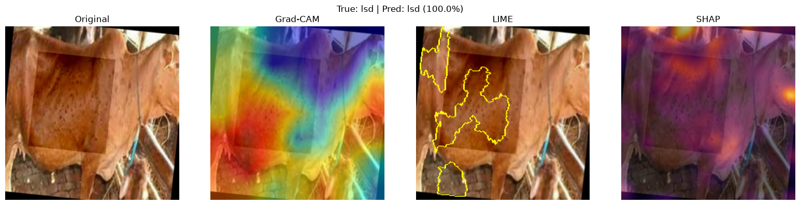
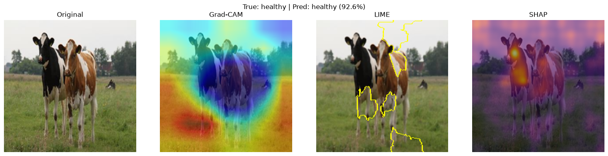

# LSD-XAI: Explainable Hybrid CNN–Transformer for Lumpy Skin Disease Detection in Cattle

**Major Project Report**

| | |
|---|---|
| Student | [Student Name] — [Roll Number] |
| Guide | [Guide Name], [Designation] |
| Department | [Department], [College / University] |
| Date | November 2026 |
| Code | https://github.com/vinay3254/lumpy-skin-disease-xai |

---

## Abstract

Lumpy Skin Disease (LSD) is a viral disease of cattle that causes skin nodules,
fever, reduced milk yield and economic loss. Early visual screening can help
farmers and veterinarians isolate affected animals sooner. This project builds
**LSD-XAI**, an explainable deep-learning system that classifies cattle images
as healthy or LSD-infected, and, in an extended 3-class setting, separates LSD
from another skin-affecting disease (foot-and-mouth disease).

The proposed model is a **hybrid CNN–Transformer**: an EfficientNet-B0 branch
extracts local texture features (nodules, lesions), a DeiT-Tiny Vision
Transformer branch captures global context, and the two are fused by either
feature concatenation or cross-attention before a fully connected classifier.
Every prediction is explained with **Grad-CAM, LIME and SHAP**.

Two public Kaggle datasets were merged (4,268 images). To avoid the train/test
leakage common in this domain, near-duplicate images were grouped with
perceptual hashing and each group was kept inside a single split. On the
held-out test set the hybrid cross-attention model reaches **93.9% accuracy,
0.945 macro-F1 and 0.990 ROC-AUC** on the 3-class task. In the binary task, an
ablation study compares CNN-only (94.1%), ViT-only (93.4%), hybrid-concat
(93.4%) and hybrid-attention (92.6%) models. The system is delivered as a web
application (FastAPI + React/TypeScript) that shows predictions together with
their visual explanations.

**Keywords:** Lumpy Skin Disease, cattle, deep learning, CNN, Vision
Transformer, hybrid model, explainable AI, Grad-CAM, LIME, SHAP.

---

## 1. Introduction

### 1.1 Background

Lumpy Skin Disease is caused by the lumpy skin disease virus (genus
*Capripoxvirus*). It spreads mainly through biting insects and shows as firm,
round skin nodules over the body. Outbreaks lead to lower milk production,
damaged hides, abortion and, in some cases, death. Diagnosis in the field relies
on visual inspection by veterinarians, who are not always available in rural
areas.

Deep learning on images can support this screening. A phone photo of an animal
can be classified in seconds. For such a tool to be trusted, it must also show
*why* it made its decision. This is the role of explainable AI (XAI).

### 1.2 Problem statement

Build an image-based system that:

1. Classifies cattle images as **Healthy** or **LSD-infected** (binary task).
2. Extends to **Healthy / LSD / Other skin disease** (3-class task).
3. Combines local (CNN) and global (Transformer) features in one hybrid model.
4. Explains every prediction visually with Grad-CAM, LIME and SHAP.
5. Is evaluated honestly, without leakage between training and test images.

### 1.3 Objectives

- Collect and merge public LSD image datasets.
- Preprocess images (resizing, noise removal, normalisation, augmentation).
- Design and train a hybrid CNN–Transformer classifier with two fusion methods.
- Run an ablation study against CNN-only and Transformer-only baselines.
- Generate visual explanations and evaluate the model with standard metrics.
- Deliver an interactive web application for demonstration.

### 1.4 Scope

In scope: binary and 3-class image classification, explanation, evaluation and
a local web demo. Out of scope: severity grading (early / moderate / severe),
because no public dataset provides severity labels; clinical validation; mobile
deployment.

---

## 2. Literature Survey

### 2.1 Convolutional neural networks

CNNs learn local spatial patterns through stacked convolutions. **EfficientNet**
(Tan and Le, 2019) scales network depth, width and input resolution together
with a compound coefficient. EfficientNet-B0 reaches strong ImageNet accuracy
with about 5.3 M parameters, which makes it suitable for small GPUs.

### 2.2 Vision Transformers

The **Vision Transformer (ViT)** (Dosovitskiy et al., 2021) splits an image into
16×16 patches, embeds them as tokens and processes them with Transformer
self-attention (Vaswani et al., 2017). Self-attention relates every patch to
every other patch, so the model captures global context. **DeiT** (Touvron et
al., 2021) trains ViTs data-efficiently; DeiT-Tiny has about 5.7 M parameters.

### 2.3 Hybrid CNN–Transformer models

CNNs are strong at local texture, while Transformers are strong at long-range
relations. Hybrid designs combine both, either by stacking (CNN stem feeding a
Transformer) or by parallel branches whose features are fused. This project
uses parallel branches, as in the proposed methodology, and compares two fusion
methods: concatenation and cross-attention.

### 2.4 Explainable AI

- **Grad-CAM** (Selvaraju et al., 2017) weights the last convolutional feature
  maps by the gradient of the class score, producing a coarse heatmap of the
  regions that drove the prediction.
- **LIME** (Ribeiro et al., 2016) perturbs an image by hiding superpixels,
  observes how the prediction changes, and fits a simple local model to find
  the superpixels that support the prediction.
- **SHAP** (Lundberg and Lee, 2017) assigns each input feature a contribution
  based on Shapley values from game theory. This project uses the gradient-based
  SHAP explainer (expected gradients) for images.

### 2.5 Image-based LSD detection

Several recent studies apply CNNs and Vision Transformers to public LSD image
datasets (Kaggle, Mendeley, Zenodo) and report accuracies above 95%. Many of
these datasets contain augmented copies of the same photograph. When such copies
fall into both the training and test sets, the reported accuracy is inflated.
This project addresses that gap explicitly (Section 3.3).

### 2.6 Research gap

1. Few works combine CNN and Transformer features *and* explain predictions
   with multiple complementary XAI methods.
2. Leakage from duplicate images is rarely controlled.
3. Most works stop at binary classification.

---

## 3. Methodology

The system follows the pipeline in Figure 1.

```
Data Acquisition → Data Preprocessing → Dataset Preparation →
Hybrid CNN–Transformer → Multi-class Classification → Explainable AI
                                     ↓                       ↓
                                  Model Evaluation  ←────────┘
```

*Figure 1: Proposed pipeline.*

### 3.1 Data acquisition

| Source (Kaggle) | Healthy | LSD | Foot-and-mouth | Total |
|---|---|---|---|---|
| `warcoder/lumpy-skin-images-dataset` | 700 | 324 | — | 1,024 |
| `devang03mgr/cattle-diseases-datasets` | 1,291 | 1,207 | 746 | 3,244 |
| **Total** | **1,991** | **1,531** | **746** | **4,268** |

Folder names were mapped to labels by keyword rules (`src/download.py`).
Unreadable files were skipped.

### 3.2 Preprocessing

1. Conversion to RGB (handles grayscale, RGBA and CMYK images).
2. **Noise removal:** median filter, kernel size 3.
3. **Resizing:** 224 × 224 pixels.
4. **Normalisation:** pixel values scaled to 0–1, then standardised with
   ImageNet mean and standard deviation.
5. **Augmentation (training only):** random resized crop (scale 0.8–1.0, acts
   as zoom), rotation ±20°, horizontal flip, brightness and contrast jitter 0.2.

### 3.3 Dataset preparation and leakage control

Each image was hashed with a 64-bit perceptual hash (pHash). Images whose hashes
differ by at most 4 bits (Hamming distance ≤ 4) were linked, and linked images
form a duplicate group (union-find). Each group was then assigned as a whole to
one split, so no near-duplicate appears in both training and test data. In the
binary set, 402 images belonged to 328 duplicate groups.

Splits are stratified by label with targets 70 / 15 / 15 and seed 42.

| Task | Train | Validation | Test | Total |
|---|---|---|---|---|
| Binary (Healthy / LSD) | 2,465 | 529 | 528 | 3,522 |
| 3-class (+ Foot-and-mouth) | 2,987 | 641 | 640 | 4,268 |

The 5-class scheme of the original proposal (healthy, early, moderate and
severe LSD, other) needs severity labels that no public dataset provides. It
was therefore reduced to the 3-class task; severity grading is future work.

### 3.4 Hybrid CNN–Transformer model

| Component | Details |
|---|---|
| CNN branch | EfficientNet-B0 (ImageNet pre-trained). Output 1280 × 7 × 7 feature map → 49 tokens, projected to 256-d |
| Transformer branch | DeiT-Tiny, patch 16, 224 input (ImageNet pre-trained). Output 197 tokens (CLS + 196 patches) × 192, projected to 256-d |
| Fusion: concat | Mean-pooled CNN vector (256) ⊕ ViT CLS vector (256) → 512 |
| Fusion: cross-attention | Multi-head attention, 4 heads: CNN tokens are queries, ViT tokens are keys/values; output mean-pooled (256) ⊕ ViT CLS (256) → 512 |
| Classifier | Linear 512→256 → GELU → Dropout 0.3 → Linear 256→classes |
| Parameters | Hybrid-attention 10.30 M; hybrid-concat 10.04 M; CNN-only 4.40 M; ViT-only 5.64 M |

For the ablation, the same class runs in *CNN-only* and *ViT-only* modes, where
only one branch feeds the classifier (input 256).

### 3.5 Training

| Setting | Value |
|---|---|
| Optimiser | AdamW, weight decay 0.05 |
| Learning rate | Head 3e-4; backbones 1e-4 (recipe v1) or 3e-5 (tuned v2) |
| Schedule | Cosine annealing |
| Loss | Class-weighted cross-entropy; label smoothing 0.1 in v2 |
| Batch size | 32, mixed precision (AMP) |
| Epochs | Max 15; early stopping on validation macro-F1 (patience 4 in v1, 6 in v2) |
| Hardware | NVIDIA RTX 4050 Laptop GPU, 6 GB; about 27 s per epoch for the hybrid |
| Seed | 42 |

The best checkpoint by validation macro-F1 is used for testing.

### 3.6 Explainability

- **Grad-CAM** on the last convolutional block (`conv_head`) of the CNN branch.
- **LIME** with quickshift superpixels; top 5 positive superpixels shown
  (500 samples for report figures, 300 in the web app for speed).
- **SHAP** with `GradientExplainer`, 20 training images as background, 50
  samples per image. Absolute values are summed over colour channels, smoothed
  with a Gaussian filter (σ = 6) to remove the 16×16 ViT patch-grid artefact,
  and overlaid on the image.

### 3.7 Evaluation metrics

Accuracy, macro precision, macro recall, macro F1, ROC-AUC (one-vs-rest for
3 classes) and the confusion matrix, all on the held-out test split.

### 3.8 System implementation

| Layer | Technology | Role |
|---|---|---|
| ML pipeline | Python 3.12, PyTorch 2.6, timm, scikit-learn | Data, model, training, evaluation |
| XAI | pytorch-grad-cam, lime, shap | Explanations |
| Backend | FastAPI, Uvicorn | REST API: `/api/predict`, `/api/shap`, `/api/results`, `/api/models`, `/api/samples` |
| Frontend | React, TypeScript, Vite, Tailwind CSS, Recharts | Diagnose, Results, About pages |
| Tests | pytest (33 tests), TypeScript build check | Correctness |

---

## 4. Results

### 4.1 Ablation study (test set)

| Run | Task | Params (M) | Accuracy | Precision | Recall | F1 | ROC-AUC |
|---|---|---|---|---|---|---|---|
| CNN only (v1) | 2-class | 4.40 | **94.13%** | 94.47% | 93.66% | **93.98%** | 98.15% |
| CNN only (v2) | 2-class | 4.40 | 94.13% | 94.63% | 93.56% | 93.96% | 97.46% |
| ViT only (v1) | 2-class | 5.64 | 93.37% | 93.37% | 93.14% | 93.24% | 97.99% |
| ViT only (v2) | 2-class | 5.64 | 92.42% | 92.22% | 92.45% | 92.32% | 97.44% |
| Hybrid concat (v1) | 2-class | 10.04 | 92.61% | 93.45% | 91.82% | 92.37% | 97.90% |
| Hybrid concat (v2) | 2-class | 10.04 | 93.37% | 93.61% | 92.94% | 93.21% | 97.67% |
| Hybrid attention (v1) | 2-class | 10.30 | 91.48% | 91.72% | 90.96% | 91.26% | 97.62% |
| Hybrid attention (v2) | 2-class | 10.30 | 92.61% | 92.55% | 92.41% | 92.48% | 97.65% |
| **Hybrid attention** | **3-class** | 10.30 | **93.91%** | **94.79%** | **94.28%** | **94.48%** | **98.99%** |

v1 = first recipe; v2 = tuned recipe (lower backbone learning rate, label
smoothing, longer patience).



*Figure 2: Confusion matrix of the 3-class hybrid cross-attention model.*



*Figure 3: ROC curves (one-vs-rest) of the 3-class model.*



*Figure 4: Loss and accuracy curves of the 3-class model.*

### 4.2 Per-class results, 3-class hybrid cross-attention

| Class | Precision | Recall | F1 | Test images |
|---|---|---|---|---|
| Healthy | 0.92 | 0.96 | 0.94 | 299 |
| LSD | 0.95 | 0.90 | 0.92 | 229 |
| Foot-and-mouth | 0.97 | 0.97 | 0.97 | 112 |

LSD has the lowest recall (0.90): about 1 in 10 LSD test images is missed.
Healthy has the lowest precision (0.92), so missed LSD images are mostly
predicted as healthy. For a screening tool this is the most important error to
reduce in future work.

### 4.3 Explainability results



*Figure 5: LSD image, predicted LSD (100%). Grad-CAM and LIME focus on the
nodule-covered flank.*



*Figure 6: Example from the binary hybrid-concat model.*

All 19 explanation figures are in `outputs/xai/`.

### 4.4 Web application

The Diagnose page accepts an uploaded or sample image, lets the user choose the
binary or 3-class model, and shows the predicted class, the per-class
probabilities, and the Grad-CAM, LIME and (on request) SHAP explanations. The
Results page shows the ablation table, a comparison chart and per-run figures.

---

## 5. Discussion

**Hybrid vs single-branch models.** In the binary task, the CNN-only model is
slightly better (94.1%) than the best hybrid (93.4%). With only about 2,500
training images, the larger hybrid (10 M parameters) overfits faster: in recipe
v1 the hybrids reached their best validation score at epoch 1. The tuned recipe
(v2) improved both hybrids by about 1 percentage point, which supports this
explanation. In the harder 3-class task, where the model must separate two
diseases with skin signs, the hybrid cross-attention model achieves the best
F1 (0.945) and ROC-AUC (0.990) of all runs. A CNN-only 3-class baseline was not
trained, so the 3-class hybrid advantage is indicated but not proven.

**Comparison with published results.** Published LSD studies often report
accuracies above 95%. Our numbers are lower but more reliable, because
near-duplicate images were kept within one split.

**Explanations.** In many LSD examples, Grad-CAM and LIME highlight the
nodule-covered skin, which supports trust in the model. In some images, Grad-CAM highlights
background or a watermark in a corner (for example
`outputs/xai/hybrid_concat_c2_v2/sample_07.png`). This indicates a possible
dataset bias (shortcut learning) and shows why explanations are needed: they
make such failure modes visible.

### 5.1 Limitations

- Small dataset from two sources; images are web-collected, not field-collected.
- No severity labels, so severity grading was not done.
- "Other skin disease" covers only foot-and-mouth disease.
- Single train/validation/test split; no k-fold cross-validation.
- No clinical validation by veterinarians.

---

## 6. Conclusion and Future Work

This project built an explainable hybrid CNN–Transformer system for Lumpy Skin
Disease detection. It merges two public datasets with leakage-controlled
splitting, trains EfficientNet-B0 + DeiT-Tiny models with two fusion methods,
compares them in an ablation study, explains predictions with Grad-CAM, LIME and
SHAP, and delivers a working web application. The best model reaches 93.9%
accuracy and 0.990 ROC-AUC on the 3-class task.

Future work:

1. Collect field images with veterinarian severity labels to enable the
   original 5-class scheme (healthy, early, moderate, severe LSD, other).
2. Add more skin diseases (ringworm, dermatophilosis, photosensitisation).
3. Use k-fold cross-validation and an external test set from a different
   source.
4. Reduce shortcut learning with background removal or cattle segmentation.
5. Deploy as an offline mobile application for farmers.

---

## References

1. M. Tan and Q. V. Le, "EfficientNet: Rethinking Model Scaling for
   Convolutional Neural Networks," *Proc. ICML*, 2019.
2. A. Dosovitskiy et al., "An Image is Worth 16x16 Words: Transformers for
   Image Recognition at Scale," *Proc. ICLR*, 2021.
3. H. Touvron et al., "Training Data-Efficient Image Transformers & Distillation
   through Attention," *Proc. ICML*, 2021.
4. A. Vaswani et al., "Attention Is All You Need," *Proc. NeurIPS*, 2017.
5. R. R. Selvaraju et al., "Grad-CAM: Visual Explanations from Deep Networks via
   Gradient-Based Localization," *Proc. ICCV*, 2017.
6. M. T. Ribeiro, S. Singh and C. Guestrin, "'Why Should I Trust You?':
   Explaining the Predictions of Any Classifier," *Proc. ACM SIGKDD*, 2016.
7. S. M. Lundberg and S.-I. Lee, "A Unified Approach to Interpreting Model
   Predictions," *Proc. NeurIPS*, 2017.
8. K. He, X. Zhang, S. Ren and J. Sun, "Deep Residual Learning for Image
   Recognition," *Proc. CVPR*, 2016.
9. Lumpy Skin Images Dataset, Kaggle:
   https://www.kaggle.com/datasets/warcoder/lumpy-skin-images-dataset
10. Cattle Diseases Datasets, Kaggle:
    https://www.kaggle.com/datasets/devang03mgr/cattle-diseases-datasets
11. World Organisation for Animal Health (WOAH), "Lumpy Skin Disease,"
    https://www.woah.org/en/disease/lumpy-skin-disease/

---

## Appendix A: Reproducing the results

```bash
.venv/bin/python -m src.download
.venv/bin/python -m src.prepare --classes 2
.venv/bin/python -m src.prepare --classes 3
.venv/bin/python -m src.train --mode hybrid --fusion attention --classes 3
.venv/bin/python -m src.train --mode hybrid --fusion concat --classes 2 \
    --backbone-lr 3e-5 --label-smoothing 0.1 --patience 6 --tag _v2
.venv/bin/python -m src.evaluate --run hybrid_attention_c3
.venv/bin/python -m src.ablation
.venv/bin/python -m src.xai --run hybrid_attention_c3 --n 9
./start.sh
```
